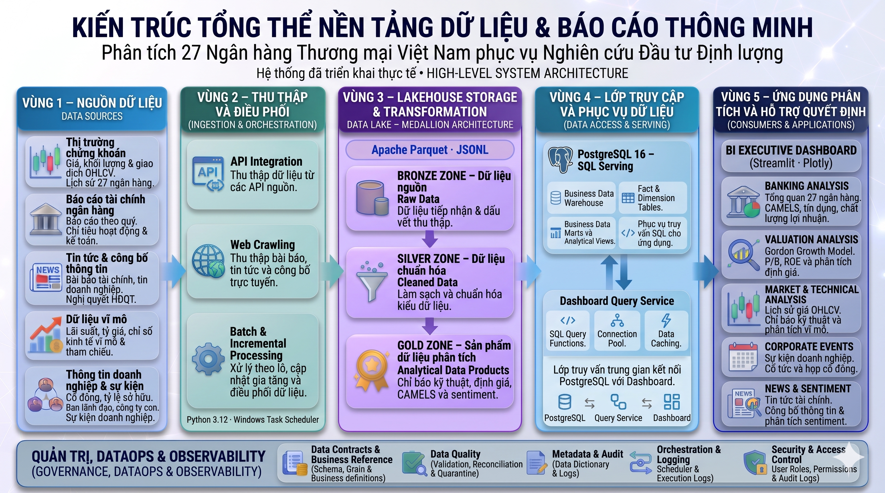
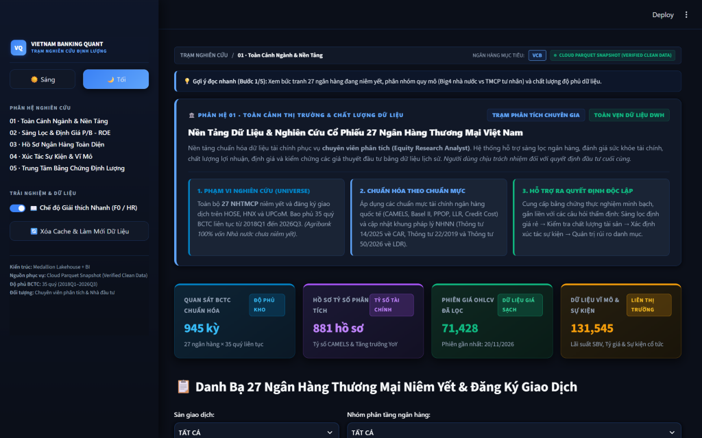
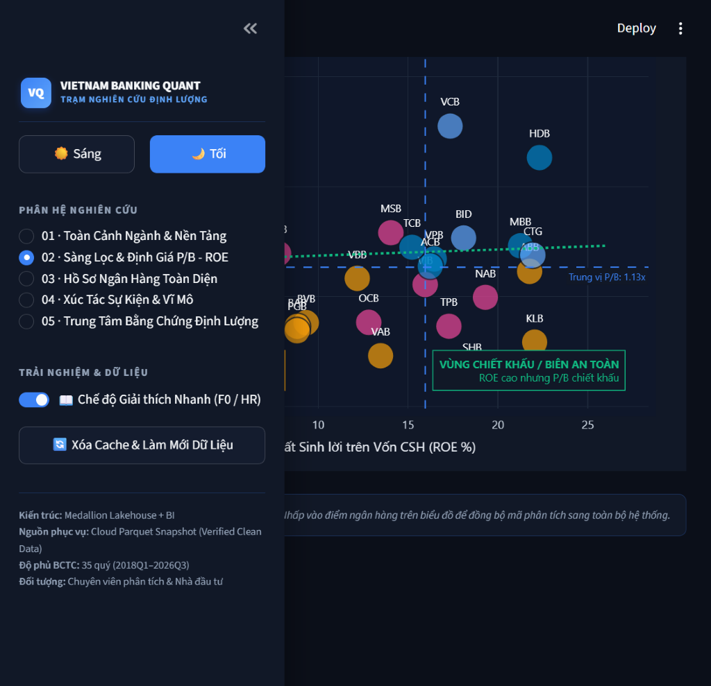
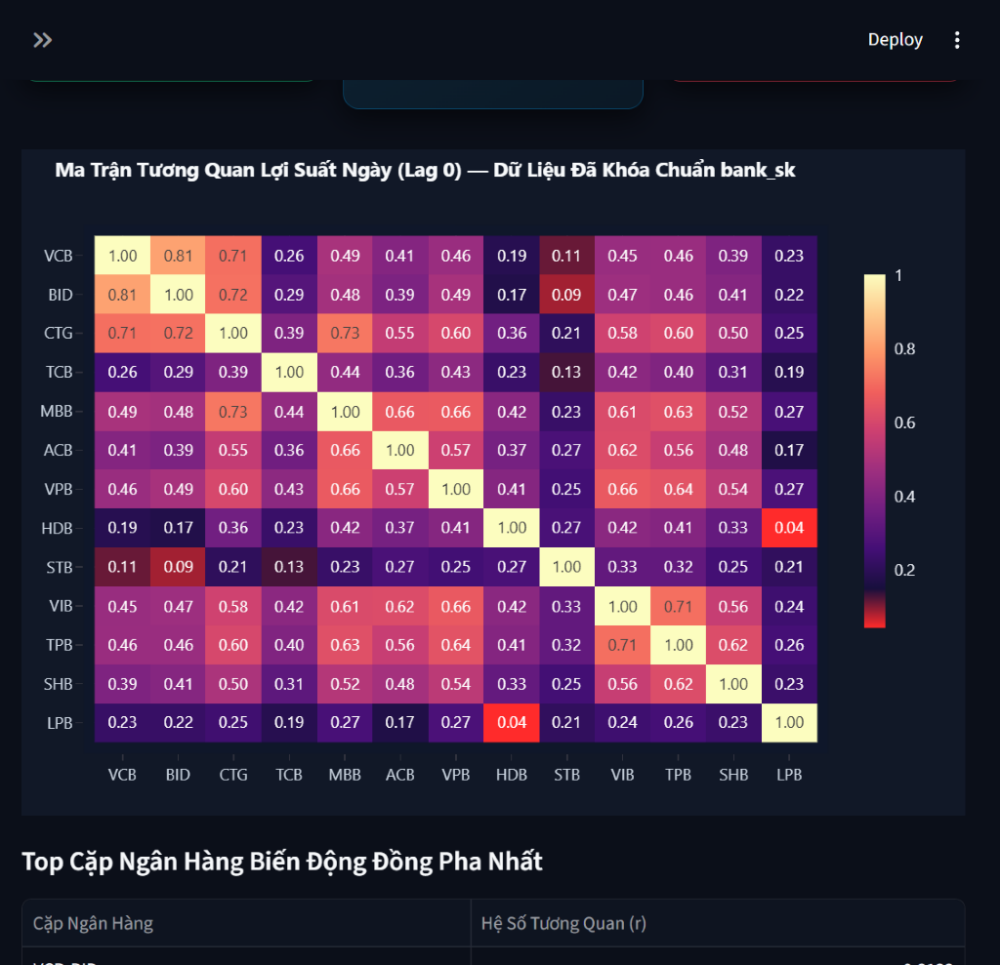

# Vietnam Banking Lakehouse & Quantitative BI Platform

[](https://www.python.org/)
[](https://www.postgresql.org/)
[](https://streamlit.io/)
[](#testing--data-quality-gates)

> **End-to-end Medallion Data Lakehouse, PostgreSQL 16 Star/Galaxy Data Warehouse, and Executive BI Workstation covering all 27 listed commercial banks in Vietnam (2018Q1–2026Q3).**
>
> 🔗 **Live Web Demo:** *(Deploy on Streamlit Community Cloud via `streamlit_app.py` — zero database setup required thanks to Dual-Mode Parquet Snapshot serving)*

---

## 1. Architecture Overview

The platform enforces **Storage–Compute Decoupling** and **1-Way Quality-Gated Lineage** from raw API/web ingestion to interactive BI consumption:

```text
API / Crawlers (OHLCV, Financials, Macro, Corporate Events, Official Disclosures)
   │
   ▼  [DQ1: Schema, Nulls & Trading Calendar -> Quarantine DLQ]
Data Lake (Medallion: 01_bronze -> 02_silver Hive Parquet -> 03_gold Analytical Marts)
   │
   ▼  [DQ2: Accounting Balance & Grain | DQ3: Domain Bounds]
Dual-Mode Serving Layer:
   ├── Local Production : PostgreSQL 16 (8 Schemas, Parameterized SQL Views)
   └── Cloud Demo Mode  : Compressed Parquet Snapshot (`data_snapshot/`, ~6.1 MB)
   │
   ▼  [@st.cache_data TTL Caching]
Streamlit Interactive BI Dashboard (5 Storytelling Modules + Guided Mode Toggle)
```



---

## 2. Key Engineering & Data Quality Challenges Solved

Rather than merely plotting raw API tables, this project resolves real-world financial data engineering pitfalls and locks them down with automated **Domain Sanity Tests** (`tests/data_quality/test_domain_sanity.py`):

1. **Surrogate Key (`bank_sk`) Alignment Across Lake & DWH:** Eliminated silent ticker-to-price scrambling caused by mismatched key ordering between Silver Parquet (alphabetical) and `dim_bank` (tier-ordered) by enforcing authoritative lookup on `ticker`.
2. **Flow vs. Stock Accounting Separation & Sign Normalization:** Separated quarterly Income Statement `provision_expense` from Balance Sheet cumulative loan-loss reserves (preventing 4x–8x Credit Cost distortion in `TOI - OPEX - Provision = PBT`), normalized negative `CIR`/`LLR` signs, and handled semi-annual `CAR` reporting via transparent carry-forward flags.
3. **Dual-Mode Zero-Setup Cloud Serving:** Engineered `apps/dashboard/services/query_service.py` to auto-detect PostgreSQL availability locally while seamlessly falling back to compressed Snappy Parquet snapshots (`data_snapshot/`) on Streamlit Community Cloud.
4. **Statistical Rigor in Quant Models:** Applied **Bank-Clustered Robust Standard Errors** for multi-quarter panel OLS (`ln(P/B) ~ ROE, NIM, NPL, CASA, |CIR|`) and **Benjamini-Hochberg FDR** multiple-testing correction for dividend event studies.

---

## 3. Five Interactive BI & Research Modules


| Module | Business Purpose | Core Capabilities |
| :--- | :--- | :--- |
| **01 · Market Overview & Data Audit** | Industry sizing & data trust | 27-bank master registry, charter capital structure by Tier (`Big4` vs `TMCP`), 35-quarter coverage audit. |
| **02 · P/B – ROE Valuation Screener** | Value screening & fair value | 35-quarter historical filter, 4-quadrant P/B–ROE scatter (click-to-sync ticker), Pooled OLS residuals & Gordon sensitivity matrix. |
| **03 · Comprehensive Bank Profile** | Fundamental due diligence | 6-pillar **CAMELS** radar vs tier peers, Credit/LDR dynamics, `TOI → PPOP → PBT` waterfall, shareholders/officers/subsidiaries, and direct links to official BCTC PDFs. |
| **04 · Market, Macro & Disclosures** | Timing, policy & catalysts | OHLCV + MA20/50/200, VN-Index & SBV Refinancing Rate (`%`) overlay, inter-bank co-movement matrix, dividend yield vs deposit benchmark, official disclosure feed. |
| **05 · Quant Evidence Hub** | Empirical hypothesis testing | Dynamic JSON-backed research cards: lag-0 co-movement, clustered OLS valuation regression, and FDR-adjusted dividend event studies. |

### Interactive Dashboard Previews

| Market Overview & Data Audit | P/B – ROE Valuation Screener | Quant Evidence Hub |
| :---: | :---: | :---: |
|  |  |  |

---

## 4. Tech Stack & Project Structure

- **Data Engineering & Storage:** Python 3.12, Pandas, PyArrow (Apache Parquet / Snappy), PostgreSQL 16 (`psycopg2`, `SQLAlchemy`)
- **Analytics & Econometrics:** NumPy, SciPy, Statsmodels (Clustered OLS, Market Model Event Study, Benjamini-Hochberg FDR)
- **Visualization & App:** Streamlit, Plotly, `AppTest` UI automation

```text
vietnam-banking-lakehouse-bi/
├── streamlit_app.py                  # Streamlit Community Cloud entrypoint
├── requirements.txt                  # Cloud & local Python dependencies
├── data_snapshot/                    # Verified clean Parquet snapshot (~6.1 MB) for Cloud Demo
├── config/
│   ├── settings.yaml                 # Runtime & SLA configuration
│   ├── business_reference/           # bank_registry.yaml (27 banks), coa_mapping.yaml
│   └── contracts/                    # metrics_dictionary.yaml, schemas.yaml
├── sql/
│   ├── migrations/                   # Sequential PostgreSQL 16 DDL migrations
│   └── views/                        # 10 analytical SQL views
├── src/stock_analysis/
│   ├── common/                       # Paths, DB utilities, trading calendar, hashing
│   ├── ingestion/                    # Market OHLCV, financial statements, macro & news crawlers
│   ├── transformation/               # bronze_to_silver/ & silver_to_gold/
│   ├── sql_serving_loader/           # Idempotent PostgreSQL Upsert loaders
│   ├── governance/                   # DQ1/DQ2/DQ3 gateways, lineage manifests, data catalog
│   ├── quant_service/                # Headless econometrics (OLS, Co-movement, Event Study)
│   └── pipeline/                     # Daily, quarterly & auxiliary orchestrators
├── apps/dashboard/                   # Streamlit app, Cobalt theme, Dual-Mode query_service & 5 modules
├── scripts/                          # CLI pipeline runner, snapshot builder, Windows Task Scheduler
└── tests/                            # Unit, Contracts, Data Quality (Domain Sanity) & AppTest Integration
```

---

## 5. Quick Start

### Run Locally (Instant Cloud Snapshot Mode — No DB Required)
```bash
pip install -r requirements.txt
streamlit run streamlit_app.py
```

### Run with Full PostgreSQL 16 Data Warehouse
1. Configure `.env` from `.env.example` (`DB_HOST`, `DB_PORT`, `DB_NAME`, `DB_USER`, `DB_PASS`, `GEMINI_API_KEY`).
2. Initialize PostgreSQL schemas/views via `sql/migrations/` and `sql/views/`.
3. Run the orchestrator: `python scripts/03_run_pipeline.py --mode daily`.

---

## 6. Testing & Data Quality Gates

Run the automated test suite (Unit formulas, Domain Sanity invariants, Query Service & Streamlit `AppTest` across all 5 modules):

```bash
set PYTHONPATH=src;.
set DATA_SOURCE_MODE=snapshot
python -m unittest tests/data_quality/test_domain_sanity.py tests/integration/test_dashboard_full.py tests/integration/test_modules_render.py tests/unit/test_unit_models.py tests/unit/test_ma_suite.py -v
```
